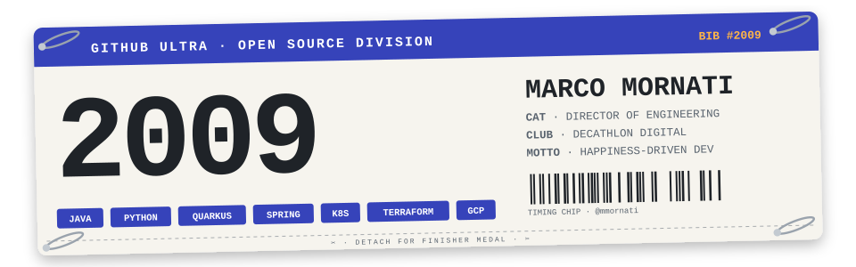

  

  <picture>
    <source media="(prefers-color-scheme: dark)" srcset="./assets/boot/boot-dark.svg" />
    <source media="(prefers-color-scheme: light)" srcset="./assets/boot/boot-light.svg" />
    
  </picture>

---

### 🏛️ Engineering Leadership & Culture
I am a **Director of Engineering** at **Decathlon Digital**, where I lead teams in building global omnichannel experiences. My leadership philosophy is rooted in **Happiness-Driven Development**, autonomy, and radical technical excellence.

- 🌍 **Scaling Platforms:** Orchestrating high-traffic systems across the global Decathlon ecosystem.
- 🧘 **Culture First:** Believer in psychological safety as the primary driver for high-performing teams.
- 🧪 **Vibe Coding:** Experimenting with AI-orchestrated development and "Zero-to-One" prototyping.
- 🧰 **AI Toolkit:** `Claude Code` · `Cursor` · `GitHub Copilot` · `MCP Toolbox` — actively shipping with them.

---

### 🕒 What I'm doing "Now"
*Inspired by the [Sivers Now page](https://nownownow.com/about) concept.*

- 🛡️ **Cyber Code Academy:** Building a secure Python sandbox for educational purposes.
- 🏠 **Smart Home:** Enhancing my [Hitachi CSNET Home integration](https://github.com/mmornati/home-assistant-csnet-home) for the Home Assistant community.
- ✍️ **Writing:** Sharing architectural deep-dives on [blog.mornati.net](https://blog.mornati.net).

---

### ⛰️ Commit Ultra-Trail

  <picture>
    <source media="(prefers-color-scheme: dark)" srcset="./assets/trail/trail-dark.svg" />
    <source media="(prefers-color-scheme: light)" srcset="./assets/trail/trail-light.svg" />
    
  </picture>

---

### 🗺️ The Mornati Massif

  <picture>
    <source media="(prefers-color-scheme: dark)" srcset="./assets/massif/massif-dark.svg" />
    <source media="(prefers-color-scheme: light)" srcset="./assets/massif/massif-light.svg" />
    
  </picture>

---

### 🏅 Finisher Medals

  <picture>
    <source media="(prefers-color-scheme: dark)" srcset="./assets/medals/medals-dark.svg" />
    <source media="(prefers-color-scheme: light)" srcset="./assets/medals/medals-light.svg" />
    
  </picture>

---

### 🛠️ The Architect's Toolkit
| **Backend & Architecture** | **DevOps & Cloud** | **Automation & Fun** |
| :--- | :--- | :--- |
|   |   |  |
|   |   |  |

---

### 🌿 git log --graph
Blog posts land on <code>main</code>, toots from <a href="https://techhub.social/@mmornati">Mastodon</a> branch off and merge back.

<!-- FEED:START -->
<pre>
| * <b>f4af2ef</b> 2026-11-22 (HEAD -&gt; toots, toot) <a href="https://techhub.social/@mmornati/117662438770270606">As a kid I played Activision's "Hacker". Black screen, "LOGON PLEASE"…</a>
|/
* <b>3c05db2</b> 2026-11-22 (blog) <a href="https://blog.mornati.net/breach-a-new-hacking-game/">BREACH: a New Hacking Game, to Learn How Real Attacks Work</a>
|\
| * <b>3f7a39d</b> 2026-11-19 (toot) <a href="https://techhub.social/@mmornati/117641855536542058">New project, new unpronounceable Greek name. I know, I know… but this…</a>
|/
* <b>8e07212</b> 2026-11-19 (blog) <a href="https://blog.mornati.net/paeon-an-on-call-colleague-for-my-home-server/">Paeon: an On-Call Colleague for My Home Server, Who Thinks Before…</a>
|\
| * <b>edf1c31</b> 2026-11-18 (toot) <a href="https://techhub.social/@mmornati/117639502307077216">When you maintain a plugin for a big project, every new release of that…</a>
|/
* <b>9901a9c</b> 2026-11-18 (blog) <a href="https://blog.mornati.net/angelia-stop-polling-for-releases-let-them-push-to-your-ci/">Stop Polling for Releases, Let Them Push to Your CI: Angelia, a…</a>
|\
| * <b>256dd78</b> 2026-11-15 (toot) <a href="https://techhub.social/@mmornati/117621562969523517">Si vous habitez à Lille et que vous avez HomeAssistant, j'ai fait…</a>
|/
* <b>0c7a865</b> 2026-11-14 (blog) <a href="https://blog.mornati.net/one-human-a-board-and-a-team-of-agents/">One Human, a Board and a Team of Agents: How I Build Software Now (and…</a>
* <i>… older history on <a href="https://blog.mornati.net">blog.mornati.net</a></i>
</pre>
<!-- FEED:END -->

---

### 📫 Let's Connect

  <i>“Move People Through the Wonders of Sport” — 🏃‍♂️ Proudly part of Decathlon Digital.</i>

